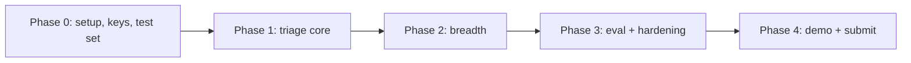

# Sajag Build Plan (Phase-wise)

Companion to [Roadmap.md](Roadmap.md). The Roadmap defines sessions and gates; this document defines exactly what to build in each phase, the files produced, and the exit checks. Stack: React + Vite + Tailwind PWA, FastAPI, Gemini (`google-genai` Interactions API), Sightengine Free Tier + Hugging Face audio, client-side `jsPDF`. Default language: Marathi.

## Pre-Build Gate (summary)

```
Plan: stateless API + PWA; no database, no Firestore, no accounts
Scale: no stored data; per-request O(len(text)) rules; Gemini free-tier limits and Sightengine 500 ops/day are the real ceilings
Security: no auth; rate limit 20/min/IP; file allowlist + 10 MB cap; secrets in host env only; dashboard behind a demo key (client-side gate only, mock data, stated explicitly)
Efficiency: send only message + rule hints + lang to Gemini (no history); safe word and PDF are fully client-side
Regression: greenfield, no existing callers; the only shared contract is the response schema (Phase 1)
Tests planned: schema contract, retry-then-fallback, rule-floor-cannot-be-lowered, privacy log scan, upload deleted on error path, media never emits "real"/"fake"
```

> [!WARNING]
> **Privacy claim vs Gemini free tier.** Google's terms for the unpaid Gemini API tier allow submitted content to be used to improve products. That conflicts with "nothing is stored". Before the demo, either (a) word the notice honestly ("text is sent to Google's Gemini API for analysis"), or (b) use a paid or Vertex key for the live demo. Verify current terms at ai.google.dev. Decide in Phase 0.

## Target repository layout

```
sajag/
  backend/
    app/
      main.py            # FastAPI app, middleware (CORS, rate limit, size/type, request id)
      config.py          # env settings (pydantic-settings)
      schemas.py         # Pydantic models: TriageIn/Out, LinkOut, MediaOut, Error
      normalize.py       # script detect, URL/phone extraction
      rules.py           # rule engine, loads data/patterns_*.json
      links.py           # lookalike, shortener, punycode, TLD checks
      llm.py             # Gemini client, prompt template, JSON schema, retry
      fuse.py            # validate + fuse + rules-only fallback
      media.py           # adapters: sightengine, hf_audio, band mapping
      routes/            # triage, link_check, media_check, safe_word, dashboard, health
    data/                # patterns_{mr,hi,en}.json, brands.json, blocklist.json, dashboard_sample.json
    tests/
    requirements.txt  .env.example
  frontend/
    src/
      i18n/              # mr.json (default), hi.json, en.json
      pages/             # Check, Media, SafeWord, Scammed, Dashboard
      components/        # ResultCard, LangToggle, PrivacyNotice, ReadAloud
      lib/               # api.ts, safeWord.ts, pdf.ts
    public/              # manifest, icons, service worker
  testset/               # 40 messages csv + eval script
  README.md  MISTAKES.md
```

## Phase 0 - Foundations (Session 0, Wed evening, ~3 h)

| # | Task | Output | Exit check |
| --- | --- | --- | --- |
| 0.1 | Create private repo, branch `feat/mvp-scaffold`, `.gitignore`, `.env.example`, secrets pre-push check | repo skeleton | push works; no `.env` tracked |
| 0.2 | Get keys: Gemini, Sightengine (API user/secret), optional HF token; decide the privacy-wording question above | keys in local `.env` | one call to each succeeds |
| 0.3 | Scaffold Vite + React + TS + Tailwind; FastAPI with `/api/health` | both run locally | health returns `{status:"ok"}` |
| 0.4 | Gemini smoke test: `client.interactions.create` with a JSON response format returning a stub triage object (confirm exact `response_format` fields via the Gemini docs MCP before coding) | `llm.py` spike | schema-valid JSON in Marathi |
| 0.5 | Deploy empty app (Vercel frontend, Render/Railway API), set env vars, CORS to the app origin | public URLs | opens on a real phone |
| 0.6 | Build the 40-message test set (20 scam / 20 genuine, balanced mr/hi/en) as `testset/messages.csv` with `lang,label,text` | test set | reviewed, personal data removed |

Gate 0: public URL works on a phone and one schema-valid Gemini result exists.

## Phase 1 - Triage core (Session 1, Thu morning, ~4 h)

1. **Schemas first** (`schemas.py`): `TriageOut {risk: low|medium|high, scam_type, reasons[<=3], next_steps[<=3], confidence, lang, mode: full|quick}`. This is the single contract the UI, tests and fallback share.
2. **Normalizer** (`normalize.py`): Devanagari vs Latin detection; extract URLs and Indian phone numbers (+91, 10-digit, spoofed formats). Pure functions, unit tested.
3. **Rule engine** (`rules.py` + `patterns_*.json`): categories digital arrest, fake investment, KYC/bank, family emergency, courier, job/lottery, loan app, sextortion; cues for urgency, secrecy, money request, impersonated authority. Output rule score, matched ids, and a risk floor.
4. **Gemini reasoning** (`llm.py`): system instruction with tone and register rules per language; message passed as quoted data in a fixed template; instruction to ignore embedded instructions; low temperature; 8 s timeout; one retry on schema failure.
5. **Fuse** (`fuse.py`): final risk = max(rule floor, model risk) when a known script matches; else model risk, never below low. On timeout or invalid output return rules-only with `mode: quick` and localized static text.
6. **Route + UI**: `POST /api/triage`; Check page with textarea, language toggle (Marathi default), `ResultCard` with colored risk, reasons, steps, and 1930 on every High result.
7. **Tests**: unit (normalizer, rules), contract (schema, retry, fallback), and a rule-floor test where a mocked model returns low on a digital-arrest script.

Gate 1: a pasted Marathi digital-arrest message returns a correct Marathi High result in under 6 s.

## Phase 2 - Feature breadth (Session 2, Thu afternoon, ~4 h)

| Feature | Backend | Frontend | Notes |
| --- | --- | --- | --- |
| Safe word | none (optional static route) | `safeWord.ts` generates phrase + challenge question locally; share text; QR via a small QR library; offline via service worker | no network needed |
| Scammed flow | none | stepper: 1930 first, evidence checklist, portal steps, incident form, `jsPDF` download | embed Noto Sans Devanagari in the PDF, or fall back to a print stylesheet |
| Link + number checks | `links.py`, `/api/link-check`, `blocklist.json` | inline in Check page when a URL or number is detected | says "cannot verify" when unknown |
| Media check | `media.py`, `/api/media-check` | Media page with file picker and band card | see below |
| Mock dashboard | `/api/dashboard` returns `sample: true` | charts, visible "Sample data" banner, demo key in URL fragment | client-side gate only; mock data |

**Media adapter design:**
- Image or screenshot: Sightengine AI-generated/deepfake models; map score to band (`<0.3 unlikely`, `0.3-0.7 unclear`, `>0.7 possible_synthetic`; tune on samples).
- Video: extract 2-3 keyframes with ffmpeg, score each with Sightengine, take the max, cap at `unclear` unless frames agree, to stay honest.
- Audio: Hugging Face audio classifier via Inference API; if unavailable, return "could not check" plus the safe word flow. Never a guess.
- Always attach `limits_note`; delete the temp file in a `finally` block; the words "real" and "fake" must not appear in any media string (a test enforces this).
- Respect Sightengine free limits (500/day, 2,000/month): add a counter that returns "could not check" past 450/day.

> [!NOTE]
> Sightengine's free tier restricts video, audio, and speech models. Confirm in its dashboard on day 0 which endpoints your key can call. If video is blocked, the keyframe-as-image approach still works; if audio is blocked, rely on HF.

Gate 2: all four features plus the dashboard work on a laptop against the local API.

## Phase 3 - Hardening and evaluation (Session 3, Fri morning, ~4 h)

1. Deploy the full app; run `testset/eval.py` against the live URL; report accuracy overall and per language. Target 34/40 and at most 3 false alarms.
2. Fix top 5 misses (rules first, then prompt); re-run until Gate 3.
3. Native-speaker review of 10 outputs per language (Marathi and Hindi).
4. Privacy test: run the test set, then check host logs for message text, URLs, numbers, file names; confirm uploads are gone.
5. Failure drills: remove the Gemini key (rules-only `quick` mode), block Sightengine (could-not-check path), oversized and wrong-type file rejects.
6. Rate limit (20/min/IP), CORS to app origin, file allowlist, secrets scan.
7. Two real phones (Chrome and Safari): text size, contrast, `ReadAloud` via the Web Speech API (check `mr-IN` voice availability; hide the button if absent), PWA install, privacy notice on first load.

Gate 3: live URL scores 85% or higher; privacy and failure drills pass.

## Phase 4 - Demo and submission (Session 4, Fri afternoon, ~3 h)

1. Record the 2-minute demo following [Testing and Demo.md](Testing%20and%20Demo.md); save on phone and laptop.
2. Pitch deck (6 slides per outline) plus a one-page district deployment note.
3. README: setup, env vars, architecture diagram, honest limitations; footer disclaimer (independent project, not official, not legal advice).
4. Rehearse twice; prepare 10 pasteable test messages and screenshots as a fallback.
5. Tag `v0.1.0-mvp`, open a PR from the feature branch, rotate keys after judging.

Gate 4: video recorded, pitch rehearsed, submitted.

## Critical path and cuts



Cut order if behind (never cut triage, safe word, privacy notice, test set): live media check, then dashboard to a screenshot, then PDF to a static checklist.

## Risks specific to this stack

| Risk | Control |
| --- | --- |
| Gemini free-tier rate limits during judging | spare key, rules-only fallback, recorded demo, test quota on Day 2 |
| Free-tier data policy contradicts the privacy claim | decide wording or use a paid key in Phase 0 |
| Devanagari glyphs broken in `jsPDF` | embed Noto Sans Devanagari; print stylesheet fallback |
| Render free-tier cold start (30-60 s) | ping health before demo |
| Marathi quality | native review, register rules in prompt, per-language accuracy reported |

