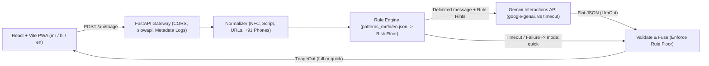

# Sajag

**Verify before you trust.**

Sajag is a multilingual, privacy-first web application (PWA) and stateless API designed to help citizens in Maharashtra and across India verify suspicious messages, links, phone numbers, and media before acting on them. Output is localized in **Marathi** (default), **Hindi**, and **English**.

Built for the **Seva First Innovation Challenge Maharashtra** (Emerging Technologies: Responsible AI, deepfake detection, cyber resilience, and digital trust).

---

## Core Capabilities

| Capability | Purpose | Status |
| --- | --- | --- |
| **Multilingual Scam Triage** (`POST /api/triage`) | Analyzes pasted text, links, and phone numbers; returns risk level (`low`, `medium`, `high`), scam category, up to 3 plain-language reasons, and up to 3 next steps. | Implemented and verified; rule-floor fusion with Gemini reasoning. |
| **Link & Number Checks** (`POST /api/link-check`) | Offline checks for brand/bank lookalike distance, URL shorteners, punycode, suspicious TLDs, and a local seeded blocklist. | Implemented and active. |
| **Synthetic Media Check — Experimental** (`POST /api/media-check`) | Scores images and extracted video keyframes (Sightengine Free Tier), and audio (Hugging Face) into cautious signal bands (`unlikely`, `unclear`, `possible_synthetic`). | Implemented with daily budget guard and safe band descriptors. |
| **Family Safe Word** | Client-side challenge phrase and callback verification checklist (shareable text + QR code) that works offline even against voice clones. | Implemented (`/safe-word`). |
| **I Was Scammed Flow** | Step-by-step emergency actions centered on India's **1930** cyber helpline (`tel:1930`), `cybercrime.gov.in`, and client-side incident PDF generation. | Implemented (`/scammed`). |
| **District Scam Dashboard** | Synthetic sample district trends clearly labeled with a visible `sample: true` banner. | Implemented (`/dashboard`). |
| **Voice Read Aloud** | In-browser speech synthesis for triage advice in Marathi (`mr-IN`), Hindi (`hi-IN`), or English. | Implemented via Web Speech API. |

---

## Architecture

Sajag keeps the API stateless with no user database. Deterministic multilingual rules establish a minimum risk floor before Gemini generates localized explanations, and a strict Pydantic schema gates every AI response.



### Design Safeguards

- **Rules-first floor (`fuse.py`):** When deterministic rules match a known scam script (e.g., `digital_arrest`, `kyc_bank`, `utility_bill`, `courier`, `investment`, `job_lottery`, `loan_app`, `family_emergency`, `sextortion`, `otp_request`), the model can raise the risk level but cannot downgrade it below the rule floor.
- **Negation-aware OTP guard:** Bank warnings such as `"do not share OTP"` are excluded from triggering OTP-theft alerts via a multilingual negation window (`do not`, `never`, `कधीही`, `नका`, `मत`, `नहीं`).
- **Prompt-injection defense:** User input is capped at 2,000 characters, wrapped inside `<message>` delimiters as untrusted data, validated strictly against `LlmOut` (`risk`, `scam_type`, `reasons[<=3]`, `next_steps[<=3]`, `confidence`), and retried at most once on schema failure.
- **Graceful fallback:** On Gemini timeout (8 s budget) or outage, the API returns `mode: "quick"` using static localized explanations for the matched category.

---

## Tech Stack

- **Backend:** Python, FastAPI, Uvicorn, Pydantic v2 (`pydantic-settings`), `google-genai` (Interactions API), `slowapi`, `httpx`, `pytest`
- **Frontend:** React 19, Vite 6, TypeScript, Tailwind CSS v4 (`@tailwindcss/vite`), `i18next` / `react-i18next`, PWA manifest + service worker
- **External Services (MVP):** Google Gemini API (`client.interactions.create`), Sightengine Free Tier (images/video keyframes), Hugging Face Inference API (optional audio signal)
- **Persistence:** None (stateless in-memory request processing; static JSON/CSV assets only)

---

## Repository Layout

```text
SevaInnoHackathon/
  backend/
    app/
      config.py          # Settings loaded from root .env
      errors.py          # Localized error responses (422, 429, 500)
      fuse.py            # Rule-floor fusion logic
      limiter.py         # SlowAPI rate limiter
      links.py           # Offline URL and phone number sanity checks
      llm.py             # Gemini Interactions API integration with retry & fallback
      main.py            # FastAPI app, middleware, routes mounting
      media.py           # Sightengine & HF audio adapters
      normalize.py       # Devanagari/Latin normalization, regex extractors
      rules.py           # Multilingual pattern evaluation engine
      schemas.py         # TriageIn, LlmOut, TriageOut, ErrorOut, HealthOut
      routes/            # triage, link_check, media_check, dashboard
    data/                # patterns_{mr,hi,en}.json, brands.json, blocklist.json, dashboard_sample.json
    scripts/
      smoke_gemini.py    # Gemini Interactions API Marathi JSON verification
      rules_baseline.py  # Rule engine baseline accuracy checker
    tests/               # 68 comprehensive unit, contract, privacy, and failure drill tests
    requirements.txt
  frontend/
    public/              # manifest.webmanifest, sw.js, icon.svg
    src/
      components/        # ResultCard, LangToggle, PrivacyNotice, ReadAloud
      pages/             # Check, SafeWord, Scammed, Media, Dashboard
      lib/               # api.ts, safeWord.ts, pdf.ts
      i18n/              # mr.json (default), hi.json, en.json
      App.tsx            # Main shell, responsive nav, lazy-loaded routes
    package.json
  datasets/              # Multilingual scam/ham seed corpora
  testset/               # 40-message balanced evaluation set + eval.py harness
  summaries/             # Phase completion documentation (PHASE_0, 1, 2)
  render.yaml            # Render deployment blueprint
  .githooks/pre-push     # Secret scanning hook
```

---

## Local Setup

### Prerequisites

- Python 3.11+
- Node.js 20+ and npm

### 1. Configure Environment and Git Hooks

Copy the environment templates and fill in your local keys (never commit `.env`):

```bash
cp .env.example .env
cp frontend/.env.example frontend/.env
git config core.hooksPath .githooks
```

| Variable | Location | Description |
| --- | --- | --- |
| `GEMINI_API_KEY` | `.env` | Google Gemini API key for `google-genai` |
| `GEMINI_MODEL` | `.env` | Model ID (`gemini-3.8-flash` in Phase 0 scaffold; `gemini-3.5-flash-lite` recommended on Free Tier for ~2.3 s latency) |
| `SIGHTENGINE_API_USER` | `.env` | Sightengine API user (Phase 2 media check) |
| `SIGHTENGINE_API_SECRET` | `.env` | Sightengine API secret (Phase 2 media check) |
| `HF_TOKEN` | `.env` | Optional Hugging Face token for audio inference (Phase 2) |
| `ALLOWED_ORIGIN` | `.env` | Comma-separated CORS origins (default: `http://localhost:5173`) |
| `RATE_LIMIT_PER_MIN` | `.env` | Per-IP rate limit (default: `20`) |
| `VITE_API_BASE_URL` | `frontend/.env` | Backend URL for the frontend (default: `http://localhost:8000`) |

### 2. Backend Setup

```bash
cd backend
python -m venv .venv
# Windows PowerShell: .venv\Scripts\Activate.ps1
# macOS / Linux:      source .venv/bin/activate
pip install -r requirements.txt
uvicorn app.main:app --reload --port 8000
```

### 3. Frontend Setup

```bash
cd frontend
npm install
npm run dev
```

### Verification Commands

```bash
# Backend tests (from repo root)
pytest backend/tests

# Gemini Interactions API Marathi smoke test (requires GEMINI_API_KEY in .env)
python backend/scripts/smoke_gemini.py

# Frontend production build check (from frontend/)
npm run build
```

---

## Privacy, Responsible AI, and Honest Limitations

- **Zero content retention:** Sajag stores no user messages, links, phone numbers, or uploaded files. Operational logs record only `req`, `method`, `path`, `status`, and `latency_ms`.
- **Gemini Free Tier notice:** Submitted text is sent to Google's Gemini API for analysis. On the Free Tier, Google's terms permit submitted prompts to be used for product improvement; the UI discloses this in the first-load privacy notice.
- **No "safe" or "real/fake" claims:** Low-risk triage results state `"No clear signs found"` and remind users to verify independently. Media checks return cautious bands only (`unlikely`, `unclear`, `possible_synthetic`), because automated detectors degrade on regional Indian languages and short audio/video clips.
- **Free-tier latency & quotas:** Full `gemini-3.x-flash` models experienced >10-25 s timeouts on the Interactions API Free Tier during Phase 0 checks (recorded on `feat/triage-core`); switching `GEMINI_MODEL` to `gemini-3.5-flash-lite` resolved latency to ~2.3 s. Sightengine Free Tier is limited to 500 operations/day (2,000/month).

---

## Documentation Index

- [Overview and Plan.md](Overview%20and%20Plan.md) — Problem statement, MVP scope, and challenge fit
- [PRD.md](PRD.md) — User personas, stories, and acceptance criteria
- [TRD.md](TRD.md) — Stack, API contracts, and non-functional requirements
- [Architecture.md](Architecture.md) — Component breakdown and failure handling
- [Build Plan.md](Build%20Plan.md) and [Phase 1 Plan.md](Phase%201%20Plan.md) — Phase-wise build tasks and Pre-Build Gate
- [Risks and Privacy.md](Risks%20and%20Privacy.md) and [Access and Permissions.md](Access%20and%20Permissions.md) — Responsible AI rules and security controls
- [Testing and Demo.md](Testing%20and%20Demo.md) and [Roadmap.md](Roadmap.md) — 40-message test plan, gates, and demo outline

---

## Disclaimer

Sajag is an independent civic technology project created for awareness and educational demonstration. It is not an official government service and does not provide legal, financial, or law-enforcement advice. If you have experienced financial cyber fraud in India, call **1930** immediately or report at **cybercrime.gov.in**.
