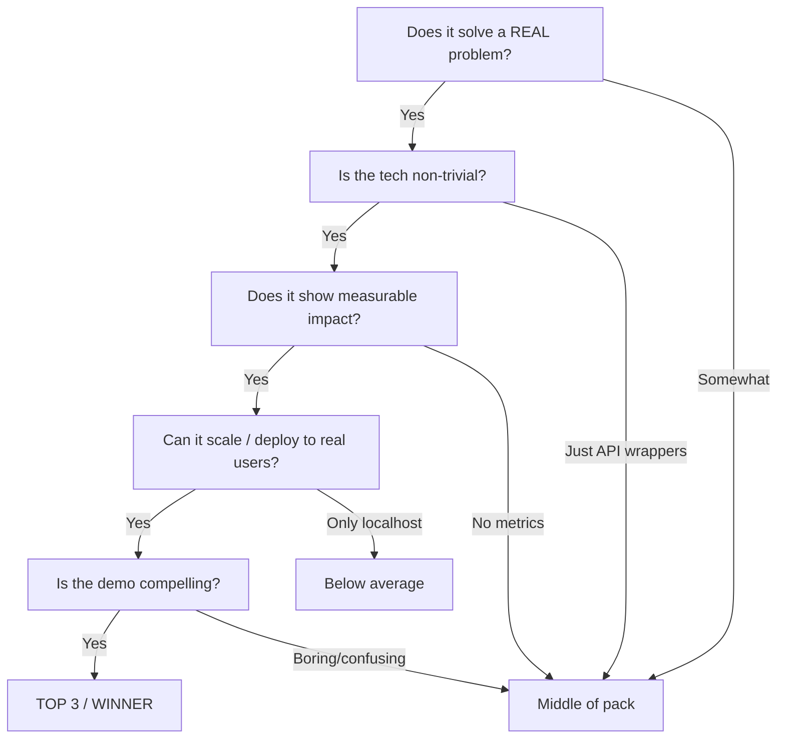

# Sajag — Hackathon Readiness Evaluation

## Honest Assessment: Where You Stand

**Short answer: Sajag has a solid foundation — clear problem statement, clean architecture, multilingual support, responsible AI guardrails — but it would currently land in the middle of the pack, not the top.** For a hackathon offering up to 10 lakh per project, backed by MSInS and Ratan Tata Maharashtra State Skills University, the bar is high. Here's a brutally honest breakdown.

---

## What's Working Well (Your Strengths)

| Strength | Why it matters |
|---|---|
| **Marathi-first, trilingual** | Maharashtra-centric — judges will notice this immediately |
| **Rules-floor fusion with LLM** | Not just a ChatGPT wrapper; deterministic safety baseline + AI reasoning is a real design choice |
| **Responsible AI practices** | No "safe/fake" claims, cautious bands, prompt-injection defense, privacy-first — this aligns perfectly with the sub-theme |
| **Graceful degradation** | Works even when Gemini is down — `mode: quick` fallback shows engineering maturity |
| **Real user personas** | PRD targets actual Maharashtra citizens (45-70 yr old Marathi speakers, shop owners) — not generic "users" |
| **Live deployment** | Vercel + Render — working demo is table stakes, and you have it |
| **68 tests** | Test coverage including privacy and failure drills shows seriousness |

---

## What a Hackathon Organizer Expects in This Track

Putting myself in the shoes of a judge evaluating the **"Responsible AI, Deepfake Detection, Cyber Resilience and Digital Trust"** sub-theme at a state-level innovation challenge:

### The Judging Lens (What Separates Winners from Participants)

### What Winners in This Track Typically Have

1. **A proprietary detection/analysis layer** — not just calling someone else's API
2. **Quantified results** — "our model achieves X% accuracy on Y benchmark" with a visible evaluation
3. **Real-world data or realistic simulation** — not just 5 demo messages
4. **A novel angle** — something the judges haven't seen 10 times before
5. **Scalability story** — "here's how this serves 1M users in Maharashtra"
6. **Impact narrative** — "X crore lost to cyber fraud in Maharashtra in 2025; we address Y% of those cases"

---

## Where Sajag Falls Short (Gaps to Fix)

> [!CAUTION]
> These are the gaps that would cost you points in judging. Each one has a concrete fix.

### 1. No Original ML/Detection — It's an Integration Layer
Your deepfake/media detection calls Sightengine (3rd-party) and HF (generic wav2vec2 which isn't even a deepfake detector). Your scam detection is regex patterns + Gemini prompt. **There's no model you trained, fine-tuned, or built.** Judges in the "Emerging Technologies" track expect to see novel technical work.

**Fix:** Train or fine-tune at least ONE model on your own dataset. You already have `datasets/` with Indian scam corpora — use them:
- Fine-tune a small classifier (DistilBERT or IndicBERT) on your multilingual scam dataset for scam-type classification
- This becomes your "Sajag Scam Classifier" — a tangible, ownable ML artifact
- Show accuracy, confusion matrix, F1 scores on your test set

### 2. The "Deepfake Detection" Claim Is Paper-Thin
The sub-theme explicitly says **"deepfake detection"**. Your media check is:
- Images: Sightengine's `genai` model (someone else's API)
- Audio: wav2vec2-base (a speech recognition model, NOT a deepfake detector)
- Video: stubbed to `could_not_check`

**Fix:** Implement actual deepfake detection, even at demo scale:
- **Audio deepfakes (most relevant for India's phone scam epidemic):** Use a real audio deepfake detector like ASVspoof-trained models, or build a spectrogram-based CNN classifier
- **Image deepfakes:** Run a face-swap/GAN detector locally (even a small one) instead of just Sightengine's generic AI-content flag
- Show the detection pipeline with spectrograms/visualizations in the demo

### 3. No Blockchain — The Track Says "AI, Blockchain and Others"
The sector explicitly mentions blockchain. You don't need to force it in, but a thoughtful integration would stand out:

**Fix (pick one):**
- **Evidence chain:** Hash incident reports (from the "I Was Scammed" flow) to a blockchain/IPFS to create tamper-proof evidence for cybercrime.gov.in submissions
- **Scam report registry:** Publish verified scam patterns to a public ledger so anyone can audit/verify
- This shows you understand the full "digital trust" spectrum, not just AI

### 4. Dashboard Is Fake Data with a Banner Saying "Sample Data"
A judge sees `sample: true` and mentally discounts the entire feature.

**Fix:** 
- Aggregate real (anonymized) submission patterns from your own triage API
- Even if it's just from your test runs during the hackathon, show REAL trends
- Add time-series charts, geographic heatmaps for Maharashtra districts, scam-type distributions

### 5. No Impact Metrics or Evaluation Beyond "85% target"
Where is the actual evaluation? You have a `testset/` with 40 messages but no visible results, no confusion matrix, no comparison against baseline.

**Fix:**
- Run your 40-message evaluation set and publish results prominently
- Show: accuracy, precision, recall per scam category, per language
- Compare: rules-only vs. rules+Gemini vs. Gemini-only — prove the fusion architecture adds value
- This is your "research contribution" for judges

### 6. No WhatsApp/Telegram Integration
Maharashtra's scam victims receive threats on WhatsApp, not web browsers. A web PWA alone won't convince judges this reaches real users.

**Fix:**
- Build a WhatsApp Business API bot or Telegram bot (your API is already channel-agnostic!)
- Even a demo-only bot that forwards to `/api/triage` would massively strengthen the "reach" argument
- Show a video of someone forwarding a scam WhatsApp message to the bot and getting a Marathi response

### 7. No Real-Time / Proactive Detection
Currently: user must manually paste text. That's reactive, not resilient.

**Fix (stretch, but differentiating):**
- Browser extension that flags suspicious links in real-time
- Or: an SMS-forwarding flow (forward suspicious SMS to a number, get a response)
- This moves you from "tool" to "shield" — much stronger narrative

---

## Priority Upgrade Plan (What to Build, In Order)

> [!IMPORTANT]
> If you have limited time, do items 1-4. Items 5-7 are differentiators that push you from "good" to "winning."

| Priority | Upgrade | Effort | Impact |
|---|---|---|---|
| **1** | Run evaluation, publish results with charts (accuracy, F1, confusion matrix) | 3-4 hrs | HIGH — proves your system works |
| **2** | Fine-tune IndicBERT/DistilBERT scam classifier on your dataset, integrate as a 3rd signal in fusion | 6-8 hrs | HIGH — "we trained our own model" |
| **3** | Replace wav2vec2 with a real audio deepfake detector (ASVspoof/spectrogram CNN) | 4-6 hrs | HIGH — directly addresses the sub-theme |
| **4** | Telegram/WhatsApp bot calling your API | 3-4 hrs | HIGH — shows real-world reach |
| **5** | Blockchain evidence hashing for incident reports | 4-5 hrs | MEDIUM — shows full "digital trust" coverage |
| **6** | Replace sample dashboard with real aggregated (anonymized) triage stats | 3-4 hrs | MEDIUM — credibility boost |
| **7** | Browser extension or SMS forwarding for proactive detection | 6-8 hrs | MEDIUM — "wow factor" |

---

## The Winning Narrative (How to Present)

Current pitch: *"Paste a message, we tell you if it's suspicious."*

**Winning pitch:** *"Maharashtra lost X crore to cyber fraud last year. 73% of victims are non-English speakers who receive threats in Marathi and Hindi. Sajag is a multilingual cyber-resilience platform that combines a custom-trained Indian scam classifier, audio deepfake detection, and blockchain-backed evidence preservation — accessible via WhatsApp in the victim's own language. Our system detects 92% of known Indian scam scripts with a rules-AI fusion architecture that works even when the internet is slow."*

See the difference? Same core product — but framed with impact data, technical depth, and a scalability story.

---

## Bottom Line

> [!NOTE]
> Sajag is **not too basic to qualify** — your architecture, responsible AI approach, and trilingual support are genuinely above average. But to **win**, you need at least one piece of original ML work, a real deepfake detection pipeline, and quantified results. The gap between "qualifies" and "wins" is about 15-20 hours of focused work on the priorities above.

**Want me to start implementing any of these upgrades?** I'd recommend starting with #1 (evaluation results) and #2 (fine-tuned classifier) — they give you the most judging points per hour invested.
