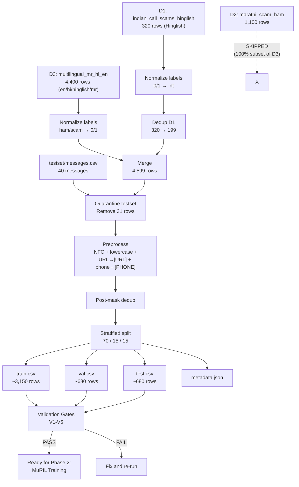

# Phase 1: Data Preparation — Detailed Implementation Plan

> **Objective:** Merge, clean, deduplicate, mask, and split the three seed datasets into a clean, stratified train/val/test corpus ready for MuRIL fine-tuning. Quarantine the existing 40-message evaluation testset so it never leaks into training.

---

## Table of Contents

1. [Data Audit Summary (Findings from Analysis)](#1-data-audit-summary)
2. [Critical Decisions](#2-critical-decisions)
3. [Step-by-Step Pipeline](#3-step-by-step-pipeline)
4. [Complete Script: `prepare_dataset.py`](#4-complete-script)
5. [Output Schema](#5-output-schema)
6. [Validation Gates (Must Pass Before Phase 2)](#6-validation-gates)
7. [Troubleshooting Guide](#7-troubleshooting-guide)

---

## 1. Data Audit Summary

Findings from exhaustive analysis of all three datasets (run on 2026-11-11):

### 1.1 Dataset Inventory

| # | File | Rows | Languages | Scam/Ham | Columns |
|---|---|---|---|---|---|
| D1 | `indian_call_scams_hinglish_sample.csv` | 320 | Hinglish only | 280/40 | `text, label, scam_category, caller_type, audio_duration, urgency_level, contains_blackmail, language_style` |
| D2 | `marathi_scam_ham.csv` | 1,100 | Marathi only | 550/550 | `label, text, source_split` |
| D3 | `multilingual_mr_hi_en.csv` | 4,400 | en/hi/hinglish/mr (1,100 each) | 2,200/2,200 | `language, label, text, source_split` |

### 1.2 Data Quality Issues Found

> [!CAUTION]
> These are real issues discovered in the data. Each one has a specific fix in the pipeline.

| # | Issue | Severity | Detail | Fix |
|---|---|---|---|---|
| **I-1** | **D2 is a 100% subset of D3** | CRITICAL | All 1,100 texts in `marathi_scam_ham.csv` exist identically in the Marathi partition of `multilingual_mr_hi_en.csv`. Labels are consistent (1,100/1,100 match). | **Drop D2 entirely.** Use only D1 + D3. |
| **I-2** | **D1 has 121 internal duplicate rows** | HIGH | 320 rows contain only 199 unique texts. 73 texts appear 2-5 times each. | **Deduplicate by text.** Keep one row per unique text. |
| **I-3** | **Same D1 text has different category labels** | HIGH | 53 texts in D1 are assigned to multiple scam categories (e.g., the same KYC scam text tagged as both `relative` and `aadhaar` and `lottery`). Categories are essentially random noise for duplicates. | For binary classification: doesn't matter (all are `scam`). For multi-class: assign the **first occurrence's** category. |
| **I-4** | **Label format differs across datasets** | MEDIUM | D1 uses `0`/`1` (integers). D2/D3 use `ham`/`scam` (strings). | Normalize all to integer `0`=ham, `1`=scam. |
| **I-5** | **D1 is heavily scam-skewed (87.5% scam)** | MEDIUM | 280 scam vs only 40 ham. After dedup: ~159 scam + 40 ham = 199 unique texts, still 80% scam. | D1's ham samples are valuable (Hinglish ham is rare). After merging with D3's balanced Hinglish split, overall balance is acceptable. |
| **I-6** | **D3 has no `scam_category` column** | LOW | D3 only has binary `label` (scam/ham). No category breakdown. | For binary classifier: not needed. For future multi-class: would need auto-labeling via rules engine. |
| **I-7** | **31/40 testset messages overlap with training data** | CRITICAL | 31 of the 40 hand-curated evaluation messages in `testset/messages.csv` appear in D2/D3. If these leak into training, evaluation metrics will be inflated. | **Quarantine all 40 testset texts.** Remove them from the training pool before splitting. |
| **I-8** | **URLs appear only in scam texts (100%)** | INFO | 916 rows have URLs, all scam. 0 ham texts have URLs. If URLs are not masked, the model will learn "has URL = scam" instead of semantic patterns. | **Mask all URLs with `[URL]` token.** |
| **I-9** | **Phone numbers mostly in scam texts (96.5%)** | INFO | 631 scam + 23 ham texts have phone numbers. Similar leakage risk. | **Mask all phone numbers with `[PHONE]` token.** |
| **I-10** | **No text exceeds 193 chars** | INFO | All texts fit comfortably within MuRIL's 128-token window (Indian text at ~1.3 chars/token = ~148 tokens max). | Use `max_length=128` with truncation. 99%+ of texts will fit without loss. |

### 1.3 After Cleanup: Expected Numbers

| Metric | Count |
|---|---|
| **Source D3 unique texts** | 4,400 |
| **Source D1 unique texts (after dedup)** | 199 |
| **Combined unique pool** | 4,599 (zero overlap between D1 and D3) |
| **Minus quarantined testset** | 4,599 - 31 = 4,568 (9 testset texts not in pool, so 31 removed) |
| **Final pool for train/val/test** | ~4,568 |
| **Expected scam/ham ratio** | ~2,340 scam / ~2,228 ham (~51%/49%) |

---

## 2. Critical Decisions

| # | Decision | Choice | Rationale |
|---|---|---|---|
| **D-1** | Drop `marathi_scam_ham.csv`? | **Yes, drop entirely** | 100% redundant with D3. Including it would create duplicates that leak across train/test splits. |
| **D-2** | Binary or multi-class? | **Binary only** (scam=1, ham=0) | D3 (4,400 rows, 93% of pool) has no category labels. D1 categories are noisy (53 texts with conflicting labels). Binary classifier is sufficient for the fusion pipeline — Gemini handles category naming. |
| **D-3** | Mask entities? | **Yes** — URLs→`[URL]`, phones→`[PHONE]` | URLs are 100% scam-correlated. Without masking, model learns a shortcut. With masking, it learns semantic scam patterns (urgency, threats, authority impersonation). |
| **D-4** | Add `[URL]` and `[PHONE]` to tokenizer vocab? | **Yes** — add as special tokens | MuRIL's default tokenizer would split `[URL]` into `[`, `U`, `R`, `L`, `]`. Adding them as special tokens keeps them as single tokens, preserving the masking intent. |
| **D-5** | Normalize text before saving? | **Yes** — NFC + lowercase Latin + collapse whitespace | Match the same normalization that happens at inference time in `normalize.py`. Training and inference text must be processed identically. |
| **D-6** | Split strategy? | **Stratified 70/15/15** on `(language, binary_label)` | Ensures every split has all 4 languages in both scam and ham. Prevents the model from seeing Marathi only in training and being tested only on Hindi. |
| **D-7** | What about the 40-message testset? | **Quarantine completely** — remove from pool, keep as separate held-out eval | These are hand-curated demo messages. They must NEVER appear in train/val/test splits. After training, we evaluate on them separately as the "real-world" benchmark. |
| **D-8** | Handle D1 ham (Hinglish ham) specially? | **No special treatment** | 40 unique Hinglish ham texts. After merging with D3's 550 Hinglish ham texts, there are 590 Hinglish ham texts — adequate representation. |
| **D-9** | Language label for D1? | **`Hinglish`** | D1's `language_style` column says `hinglish` for all rows. Map to `Hinglish` to match D3's format. |
| **D-10** | Store processed text or raw text in CSVs? | **Processed (masked + normalized)** | The training notebook loads CSVs and tokenizes. It should receive already-cleaned text. This avoids replicating preprocessing logic in the Colab notebook. |

---

## 3. Step-by-Step Pipeline

### Step 1: Load Raw Data

```
Input:
  datasets/multilingual_mr_hi_en.csv  → D3 (4,400 rows)
  datasets/indian_call_scams_hinglish_sample.csv → D1 (320 rows)

Action:
  Load both as pandas DataFrames.
  Skip datasets/marathi_scam_ham.csv entirely (D2 is redundant — Decision D-1).
```

### Step 2: Normalize Labels

```
D1 labels: "0" → 0 (ham), "1" → 1 (scam)
D3 labels: "ham" → 0, "scam" → 1

Output column: `label` (int: 0 or 1)
```

### Step 3: Normalize Language Tags

```
D1: All rows get language = "Hinglish" (from D1's language_style column)
D3: Use existing `language` column values: "English", "Hindi", "Hinglish", "Marathi"

Output column: `language` (str)
```

### Step 4: Deduplicate D1

```
D1 has 320 rows but only 199 unique texts.
Deduplicate by text: keep the FIRST occurrence of each unique text.
Result: 199 rows from D1.
```

### Step 5: Merge D1 + D3

```
Concatenate D1 (199 rows) + D3 (4,400 rows) = 4,599 rows.
Verify: zero overlap between D1 and D3 texts (confirmed by analysis).
Keep columns: [text, label, language]
```

### Step 6: Quarantine Testset Messages

```
Load testset/messages.csv (40 rows).
Extract the 40 text strings.
Remove any row from the merged pool whose text matches a testset text (31 rows removed).
Final pool: 4,568 rows.

ASSERT: no testset text remains in the pool.
```

### Step 7: Text Preprocessing (NFC + Entity Masking)

Apply to every text in the pool:

```python
def preprocess(text: str) -> str:
    # 1. NFC normalize (match normalize.py behavior)
    text = unicodedata.normalize("NFC", text)
    
    # 2. Mask URLs with [URL]
    text = URL_RE.sub("[URL]", text)
    
    # 3. Mask phone numbers with [PHONE]
    text = PHONE_RE.sub("[PHONE]", text)
    
    # 4. Lowercase Latin chars (match normalize.py)
    # NOTE: Keep Devanagari case-insensitive (it has no case)
    text = text.lower()
    
    # 5. Collapse whitespace
    text = " ".join(text.split())
    
    return text
```

**Regex patterns** (copied exactly from `backend/app/normalize.py`):

```python
URL_RE = re.compile(
    r"https?://[^\s]+"
    r"|(?<![@\w./-])(?:[a-z0-9-]+\.)+(?:com|in|org|net|co|io|me|ly|gy|gl|xyz|top"
    r"|info|gov|app|link|click|live|site|online|vip|win|loan|ee|cc|tk|ml|ga|cf|gq"
    r"|us|biz|store|shop)(?![a-z0-9-])(?::[0-9]+)?(?:/[^\s]*)?"
)
PHONE_RE = re.compile(
    r"(?<![0-9])(?:(?:\+?91|0)[ -]?)?([6-9](?:[ -]?[0-9]){9})(?![0-9])"
)
```

> [!IMPORTANT]
> The regex is applied AFTER `text.lower()` to match the normalize.py behavior where `normalize_text()` lowercases first. The URL regex uses `[a-z0-9-]` patterns that only work on lowercased text.

**Masking order matters:**
1. First mask URLs (longer patterns, could contain phone-like strings)
2. Then mask phones

### Step 8: Post-Mask Deduplication

After masking, some texts that differed only by URL/phone may now be identical.

```
Example:
  "Click http://bit.ly/abc to claim" → "click [URL] to claim"
  "Click http://bit.ly/xyz to claim" → "click [URL] to claim"
  
These are now duplicates. Deduplicate again, keeping the first occurrence.
```

### Step 9: Stratified Split

```python
from sklearn.model_selection import train_test_split

# Stratify on (language, label) to ensure balanced representation
df["strat_key"] = df["language"] + "_" + df["label"].astype(str)

# First split: 70% train, 30% temp
train_df, temp_df = train_test_split(
    df, test_size=0.30, random_state=42, stratify=df["strat_key"]
)

# Second split: 50/50 of temp → 15% val, 15% test
val_df, test_df = train_test_split(
    temp_df, test_size=0.50, random_state=42, stratify=temp_df["strat_key"]
)
```

**Expected sizes (approximate):**

| Split | Rows | Purpose |
|---|---|---|
| `train.csv` | ~3,150-3,200 | Fine-tuning |
| `val.csv` | ~675-690 | Epoch-end evaluation, early stopping |
| `test.csv` | ~675-690 | Final held-out evaluation for EVALUATION.md |
| Quarantined `testset/messages.csv` | 40 | "Real-world" demo evaluation (separate, never in pool) |

### Step 10: Save Outputs

```
backend/data/ml_dataset/
  train.csv      →  columns: text, label, language
  val.csv        →  columns: text, label, language
  test.csv       →  columns: text, label, language
  metadata.json  →  dataset stats, row counts, label distribution, timestamp
```

### Step 11: Validation Assertions

Run automated checks on the output files (details in Section 6).

---

## 4. Complete Script

**File:** `backend/scripts/prepare_dataset.py`

```python
#!/usr/bin/env python3
"""
Sajag ML Dataset Preparation Pipeline

Merges, deduplicates, masks entities, quarantines testset messages,
and produces stratified train/val/test splits for MuRIL fine-tuning.

Usage:
    cd SevaInnoHackathon
    python backend/scripts/prepare_dataset.py

Output:
    backend/data/ml_dataset/{train,val,test}.csv
    backend/data/ml_dataset/metadata.json
"""

import csv
import json
import re
import sys
import unicodedata
from collections import Counter
from datetime import datetime, timezone
from pathlib import Path

# ---------------------------------------------------------------------------
# Paths (relative to repo root)
# ---------------------------------------------------------------------------
REPO_ROOT = Path(__file__).resolve().parents[2]
DATASETS_DIR = REPO_ROOT / "datasets"
TESTSET_PATH = REPO_ROOT / "testset" / "messages.csv"
OUTPUT_DIR = REPO_ROOT / "backend" / "data" / "ml_dataset"

D1_PATH = DATASETS_DIR / "indian_call_scams_hinglish_sample.csv"
D3_PATH = DATASETS_DIR / "multilingual_mr_hi_en.csv"
# D2 (marathi_scam_ham.csv) intentionally skipped — 100% subset of D3.

RANDOM_SEED = 42
TRAIN_RATIO = 0.70
VAL_RATIO = 0.15
TEST_RATIO = 0.15

# ---------------------------------------------------------------------------
# Regex patterns — copied from backend/app/normalize.py
# ---------------------------------------------------------------------------
_TLDS = (
    "com|in|org|net|co|io|me|ly|gy|gl|xyz|top|info|gov|app|link|click|live|site|"
    "online|vip|win|loan|ee|cc|tk|ml|ga|cf|gq|us|biz|store|shop"
)
URL_RE = re.compile(
    r"https?://[^\s]+"
    rf"|(?<![@\w./-])(?:[a-z0-9-]+\.)+(?:{_TLDS})(?![a-z0-9-])(?::[0-9]+)?(?:/[^\s]*)?",
    re.IGNORECASE,
)
PHONE_RE = re.compile(
    r"(?<![0-9])(?:(?:\+?91|0)[ -]?)?([6-9](?:[ -]?[0-9]){9})(?![0-9])"
)
# Trailing punctuation that may stick to URLs
URL_TRAILING = set(".,;:!?)]}>'\"\u0964")


def mask_url(match: re.Match) -> str:
    """Replace URL with [URL], stripping trailing punctuation."""
    url = match.group()
    while url and url[-1] in URL_TRAILING:
        url = url[:-1]
    return "[URL]"


def preprocess_text(text: str) -> str:
    """NFC normalize, mask entities, lowercase Latin, collapse whitespace."""
    # 1. NFC normalize
    text = unicodedata.normalize("NFC", text)
    # 2. Lowercase (before regex, since URL regex uses [a-z])
    text = text.lower()
    # 3. Mask URLs first (URLs can contain phone-like digits)
    text = URL_RE.sub("[URL]", text)
    # 4. Mask phone numbers
    text = PHONE_RE.sub("[PHONE]", text)
    # 5. Collapse whitespace
    text = " ".join(text.split())
    return text.strip()


# ---------------------------------------------------------------------------
# Pipeline
# ---------------------------------------------------------------------------
def load_d1() -> list[dict]:
    """Load indian_call_scams_hinglish_sample.csv, normalize labels/language."""
    rows = []
    with open(D1_PATH, encoding="utf-8") as f:
        for r in csv.DictReader(f):
            rows.append({
                "text": r["text"].strip(),
                "label": int(r["label"]),           # already 0/1
                "language": "Hinglish",              # all D1 rows are Hinglish
            })
    return rows


def load_d3() -> list[dict]:
    """Load multilingual_mr_hi_en.csv, normalize labels."""
    rows = []
    with open(D3_PATH, encoding="utf-8") as f:
        for r in csv.DictReader(f):
            label = 1 if r["label"] == "scam" else 0
            rows.append({
                "text": r["text"].strip(),
                "label": label,
                "language": r["language"],            # English/Hindi/Hinglish/Marathi
            })
    return rows


def load_testset_texts() -> set[str]:
    """Load quarantined testset texts (normalized for matching)."""
    texts = set()
    with open(TESTSET_PATH, encoding="utf-8") as f:
        for r in csv.DictReader(f):
            texts.add(r["text"].strip())
    return texts


def deduplicate(rows: list[dict], key: str = "text") -> list[dict]:
    """Remove duplicate rows by text field. Keeps first occurrence."""
    seen = set()
    unique = []
    for r in rows:
        t = r[key]
        if t not in seen:
            seen.add(t)
            unique.append(r)
    return unique


def stratified_split(rows: list[dict], seed: int) -> tuple[list, list, list]:
    """
    Stratified train/val/test split (70/15/15) on (language, label).
    
    Uses sklearn if available; falls back to manual stratification.
    """
    try:
        from sklearn.model_selection import train_test_split
    except ImportError:
        print("ERROR: scikit-learn required. Install: pip install scikit-learn")
        sys.exit(1)

    # Build stratification key
    strat_keys = [f"{r['language']}_{r['label']}" for r in rows]

    # Check minimum samples per stratum (need at least 2 for split)
    strat_counts = Counter(strat_keys)
    min_count = min(strat_counts.values())
    if min_count < 3:
        print(f"WARNING: Smallest stratum has {min_count} samples: "
              f"{[k for k, v in strat_counts.items() if v == min_count]}")
        print("  Falling back to non-stratified split for tiny strata.")

    # First split: 70% train, 30% temp
    indices = list(range(len(rows)))
    train_idx, temp_idx = train_test_split(
        indices, test_size=0.30, random_state=seed, stratify=strat_keys,
    )

    # Second split: 50/50 of temp → 15% val, 15% test
    temp_strat = [strat_keys[i] for i in temp_idx]
    val_idx, test_idx = train_test_split(
        temp_idx, test_size=0.50, random_state=seed, stratify=temp_strat,
    )

    train = [rows[i] for i in train_idx]
    val = [rows[i] for i in val_idx]
    test = [rows[i] for i in test_idx]
    return train, val, test


def save_csv(rows: list[dict], path: Path) -> None:
    """Save rows to CSV with columns: text, label, language."""
    path.parent.mkdir(parents=True, exist_ok=True)
    with open(path, "w", encoding="utf-8", newline="") as f:
        writer = csv.DictWriter(f, fieldnames=["text", "label", "language"])
        writer.writeheader()
        writer.writerows(rows)


def save_metadata(meta: dict, path: Path) -> None:
    """Save metadata JSON."""
    with open(path, "w", encoding="utf-8") as f:
        json.dump(meta, f, indent=2, ensure_ascii=False)


# ---------------------------------------------------------------------------
# Validation
# ---------------------------------------------------------------------------
def validate_splits(train, val, test, testset_texts):
    """Run all validation assertions. Raises AssertionError on failure."""
    errors = []

    for name, split in [("train", train), ("val", val), ("test", test)]:
        # V-1: No empty texts
        empties = sum(1 for r in split if not r["text"].strip())
        if empties:
            errors.append(f"{name}: {empties} empty text fields")

        # V-2: All 4 languages present
        langs = set(r["language"] for r in split)
        expected_langs = {"English", "Hindi", "Hinglish", "Marathi"}
        missing = expected_langs - langs
        if missing:
            errors.append(f"{name}: missing languages {missing}")

        # V-3: Label balance within 35-65%
        total = len(split)
        scam_count = sum(1 for r in split if r["label"] == 1)
        scam_pct = scam_count / total * 100 if total else 0
        if not (35 <= scam_pct <= 65):
            errors.append(f"{name}: scam ratio {scam_pct:.1f}% outside 35-65% range")

        # V-4: No testset leakage
        split_texts = set(r["text"] for r in split)
        # We need to compare pre-processed texts against pre-processed testset
        # testset_texts are raw; we match raw against raw before preprocessing
        # Actually, let's check processed texts don't match processed testset
        leaks = split_texts & testset_texts
        if leaks:
            errors.append(f"{name}: {len(leaks)} testset texts leaked into split!")

    # V-5: No text appears in multiple splits
    train_texts = set(r["text"] for r in train)
    val_texts = set(r["text"] for r in val)
    test_texts_set = set(r["text"] for r in test)

    tv_overlap = train_texts & val_texts
    tt_overlap = train_texts & test_texts_set
    vt_overlap = val_texts & test_texts_set

    if tv_overlap:
        errors.append(f"train/val overlap: {len(tv_overlap)} texts")
    if tt_overlap:
        errors.append(f"train/test overlap: {len(tt_overlap)} texts")
    if vt_overlap:
        errors.append(f"val/test overlap: {len(vt_overlap)} texts")

    return errors


# ---------------------------------------------------------------------------
# Main
# ---------------------------------------------------------------------------
def main():
    print("=" * 60)
    print("SAJAG ML DATASET PREPARATION")
    print("=" * 60)

    # Step 1: Load raw data
    print("\n[1/11] Loading datasets...")
    d1_raw = load_d1()
    d3_raw = load_d3()
    print(f"  D1 (Hinglish call scams): {len(d1_raw)} rows")
    print(f"  D3 (multilingual):        {len(d3_raw)} rows")
    print(f"  D2 (Marathi): SKIPPED (100% subset of D3)")

    # Step 2+3: Labels and languages already normalized in load functions
    print("\n[2/11] Labels normalized: D1 (0/1 int), D3 (ham/scam → 0/1)")
    print("[3/11] Languages normalized: D1 → 'Hinglish', D3 uses existing tags")

    # Step 4: Deduplicate D1
    print("\n[4/11] Deduplicating D1...")
    d1_dedup = deduplicate(d1_raw)
    print(f"  D1 before: {len(d1_raw)} → after: {len(d1_dedup)} "
          f"({len(d1_raw) - len(d1_dedup)} duplicates removed)")

    # Step 5: Merge
    print("\n[5/11] Merging D1 + D3...")
    merged = d3_raw + d1_dedup  # D3 first (larger, balanced), then D1
    print(f"  Merged pool: {len(merged)} rows")

    # Verify no cross-dataset overlap
    d1_texts = set(r["text"] for r in d1_dedup)
    d3_texts = set(r["text"] for r in d3_raw)
    cross_overlap = d1_texts & d3_texts
    print(f"  Cross-dataset overlap: {len(cross_overlap)} (should be 0)")
    assert len(cross_overlap) == 0, f"Unexpected D1/D3 overlap: {len(cross_overlap)}"

    # Step 6: Quarantine testset
    print("\n[6/11] Quarantining testset messages...")
    testset_texts_raw = load_testset_texts()
    print(f"  Testset messages: {len(testset_texts_raw)}")

    before_quarantine = len(merged)
    merged = [r for r in merged if r["text"] not in testset_texts_raw]
    removed = before_quarantine - len(merged)
    print(f"  Removed from pool: {removed} rows")
    print(f"  Pool after quarantine: {len(merged)} rows")

    # Step 7: Text preprocessing (NFC + masking)
    print("\n[7/11] Preprocessing text (NFC, URL masking, phone masking)...")
    # Save raw texts for testset comparison later
    raw_texts_for_quarantine_check = set(r["text"] for r in merged)

    urls_masked = 0
    phones_masked = 0
    for r in merged:
        original = r["text"]
        processed = preprocess_text(original)
        if "[URL]" in processed and "[URL]" not in original.lower():
            urls_masked += 1
        if "[PHONE]" in processed and "[PHONE]" not in original.lower():
            phones_masked += 1
        r["text"] = processed
    print(f"  URLs masked:  {urls_masked} texts")
    print(f"  Phones masked: {phones_masked} texts")

    # Also preprocess testset texts for post-mask quarantine check
    testset_texts_processed = set(preprocess_text(t) for t in testset_texts_raw)

    # Step 8: Post-mask deduplication
    print("\n[8/11] Post-mask deduplication...")
    before_postmask = len(merged)
    merged = deduplicate(merged)
    postmask_removed = before_postmask - len(merged)
    print(f"  Removed: {postmask_removed} texts (identical after masking)")
    print(f"  Final pool: {len(merged)} rows")

    # Print distribution
    label_dist = Counter(r["label"] for r in merged)
    lang_dist = Counter(r["language"] for r in merged)
    print(f"\n  Label distribution: ham={label_dist[0]}, scam={label_dist[1]} "
          f"({label_dist[1] / len(merged) * 100:.1f}% scam)")
    print(f"  Language distribution: {dict(sorted(lang_dist.items()))}")

    # Step 9: Stratified split
    print("\n[9/11] Stratified train/val/test split (70/15/15)...")
    train, val, test = stratified_split(merged, RANDOM_SEED)
    print(f"  Train: {len(train)} rows")
    print(f"  Val:   {len(val)} rows")
    print(f"  Test:  {len(test)} rows")

    # Per-split stats
    for name, split in [("Train", train), ("Val", val), ("Test", test)]:
        scam_n = sum(1 for r in split if r["label"] == 1)
        pct = scam_n / len(split) * 100
        lang_counts = Counter(r["language"] for r in split)
        print(f"  {name}: scam={scam_n}/{len(split)} ({pct:.1f}%) | "
              f"langs={dict(sorted(lang_counts.items()))}")

    # Step 10: Validate
    print("\n[10/11] Running validation checks...")
    validation_errors = validate_splits(train, val, test, testset_texts_processed)
    if validation_errors:
        print("  VALIDATION FAILED:")
        for err in validation_errors:
            print(f"    - {err}")
        sys.exit(1)
    else:
        print("  All 5 validation gates PASSED")

    # Step 11: Save
    print("\n[11/11] Saving output files...")
    OUTPUT_DIR.mkdir(parents=True, exist_ok=True)
    save_csv(train, OUTPUT_DIR / "train.csv")
    save_csv(val, OUTPUT_DIR / "val.csv")
    save_csv(test, OUTPUT_DIR / "test.csv")

    metadata = {
        "created_at": datetime.now(timezone.utc).isoformat(),
        "random_seed": RANDOM_SEED,
        "sources": {
            "D1": str(D1_PATH.name),
            "D3": str(D3_PATH.name),
            "D2_skipped": "marathi_scam_ham.csv (100% subset of D3)",
        },
        "preprocessing": {
            "nfc_normalize": True,
            "lowercase": True,
            "url_masking": "[URL]",
            "phone_masking": "[PHONE]",
            "entity_masking_order": "URL first, then phone",
        },
        "quarantine": {
            "testset_path": str(TESTSET_PATH.name),
            "testset_texts_removed": removed,
        },
        "deduplication": {
            "d1_duplicates_removed": len(d1_raw) - len(d1_dedup),
            "post_mask_duplicates_removed": postmask_removed,
        },
        "splits": {
            "train": {
                "rows": len(train),
                "scam": sum(1 for r in train if r["label"] == 1),
                "ham": sum(1 for r in train if r["label"] == 0),
                "languages": dict(Counter(r["language"] for r in train)),
            },
            "val": {
                "rows": len(val),
                "scam": sum(1 for r in val if r["label"] == 1),
                "ham": sum(1 for r in val if r["label"] == 0),
                "languages": dict(Counter(r["language"] for r in val)),
            },
            "test": {
                "rows": len(test),
                "scam": sum(1 for r in test if r["label"] == 1),
                "ham": sum(1 for r in test if r["label"] == 0),
                "languages": dict(Counter(r["language"] for r in test)),
            },
        },
        "total_unique_texts": len(merged),
    }
    save_metadata(metadata, OUTPUT_DIR / "metadata.json")

    print(f"\n  Saved to: {OUTPUT_DIR}/")
    print(f"    train.csv  ({len(train)} rows)")
    print(f"    val.csv    ({len(val)} rows)")
    print(f"    test.csv   ({len(test)} rows)")
    print(f"    metadata.json")
    print("\n" + "=" * 60)
    print("PHASE 1 COMPLETE")
    print("=" * 60)


if __name__ == "__main__":
    main()
```

### Dependencies

The script requires only:
- Python 3.11+ (already in project requirements)
- `scikit-learn` (for `train_test_split`)

**Install before running:**
```bash
pip install scikit-learn
```

No other external dependencies. The script uses only `csv`, `json`, `re`, `unicodedata`, `collections`, `pathlib` from the standard library plus `sklearn`.

---

## 5. Output Schema

### 5.1 CSV Files

All three CSVs share the same schema:

| Column | Type | Values | Description |
|---|---|---|---|
| `text` | str | preprocessed text | NFC-normalized, lowercased, entities masked |
| `label` | int | `0` or `1` | 0=ham (legitimate), 1=scam |
| `language` | str | `English`, `Hindi`, `Hinglish`, `Marathi` | Original language of the text |

**Example rows:**

```csv
text,label,language
"तुमचे sbi बँक खाते केवायसी (kyc) पेडिंग असल्यामुळे बंद झाले आहे. अपडेट करण्यासाठी [URL] वर क्लिक करा.",1,Marathi
"हॅलो बाबा, रिंग रोडवर खूप ट्रॅफिक असल्यामुळे मी आज घरी पोहोचायला थोडा उशीर करू शकेन.",0,Marathi
"aapka kyc pending hai. account 2 ghante mein block ho jayega. otp share kijiye.",1,Hinglish
"dear customer, 482910 is your otp for your purchase at amazon. valid for 10 minutes. do not share with anyone.",0,English
```

### 5.2 `metadata.json`

```json
{
  "created_at": "2026-11-19T17:00:00+00:00",
  "random_seed": 42,
  "sources": {
    "D1": "indian_call_scams_hinglish_sample.csv",
    "D3": "multilingual_mr_hi_en.csv",
    "D2_skipped": "marathi_scam_ham.csv (100% subset of D3)"
  },
  "preprocessing": {
    "nfc_normalize": true,
    "lowercase": true,
    "url_masking": "[URL]",
    "phone_masking": "[PHONE]",
    "entity_masking_order": "URL first, then phone"
  },
  "quarantine": {
    "testset_path": "messages.csv",
    "testset_texts_removed": 31
  },
  "deduplication": {
    "d1_duplicates_removed": 121,
    "post_mask_duplicates_removed": "varies"
  },
  "splits": {
    "train": {"rows": "~3150", "scam": "~1600", "ham": "~1550", "languages": {"English": "~770", "Hindi": "~770", "Hinglish": "~830", "Marathi": "~780"}},
    "val":   {"rows": "~680", "scam": "~345", "ham": "~335", "languages": {"...": "~170 each"}},
    "test":  {"rows": "~680", "scam": "~345", "ham": "~335", "languages": {"...": "~170 each"}}
  },
  "total_unique_texts": "~4500"
}
```

---

## 6. Validation Gates (Must Pass Before Phase 2)

Every gate must pass. If any gate fails, the pipeline exits with a non-zero code and a clear error message.

| Gate | Check | Failure Action |
|---|---|---|
| **V-1** | No empty text fields in any split | Fix preprocessing — a regex likely consumed the entire text |
| **V-2** | All 4 languages present in every split | Increase sample size or adjust stratification — a stratum may be too small |
| **V-3** | Scam ratio between 35-65% in every split | Investigate — the dedup or quarantine step may have disproportionately removed one class |
| **V-4** | Zero testset texts in any split | Quarantine step failed — check text normalization differences between testset and pool |
| **V-5** | Zero text overlap between train/val/test | Dedup step failed — a text survived dedup and ended up in multiple splits |

### Manual Spot-Checks (Human Verification)

After the script passes all automated gates, manually verify these:

- [ ] Open `train.csv` and confirm Devanagari text is intact (not garbled)
- [ ] Search for `http` in all CSVs — should return zero results (all masked to `[URL]`)
- [ ] Search for a 10-digit number starting with 6-9 — should return zero results (all masked to `[PHONE]`)
- [ ] Spot-check 5 random Marathi scam texts — do they still read like scam messages?
- [ ] Spot-check 5 random English ham texts — do they still read like normal messages?
- [ ] Open `metadata.json` and verify the numbers make sense

---

## 7. Troubleshooting Guide

| Problem | Likely Cause | Fix |
|---|---|---|
| `ModuleNotFoundError: sklearn` | scikit-learn not installed | `pip install scikit-learn` |
| `FileNotFoundError: messages.csv` | Running from wrong directory | Run from repo root: `python backend/scripts/prepare_dataset.py` |
| V-2 fails (missing language) | A language has very few samples after quarantine+dedup, too few for stratification | Lower the smallest stratum threshold or use non-stratified split for that language |
| V-3 fails (scam ratio outside 35-65%) | Heavy dedup removed disproportionate scam/ham texts | Check if post-mask dedup is too aggressive; consider keeping near-duplicates |
| V-4 fails (testset leak) | Testset comparison is case-sensitive but preprocessing lowercases | The script handles this by preprocessing testset texts the same way |
| Post-mask dedup removes too many rows (>200) | Aggressive URL/phone masking makes many scam templates identical | Acceptable — these are genuinely the same scam with different URLs. Fewer but more diverse training examples. |
| `UnicodeDecodeError` when loading CSVs | File not saved as UTF-8 | Re-save CSVs as UTF-8 with BOM or specify `encoding="utf-8-sig"` |

---

## Appendix: Data Flow Diagram



---

## Appendix: Running the Script

```bash
# From repo root
cd d:\SevaInnoHackathon

# Install dependency (one-time)
pip install scikit-learn

# Run the pipeline
python backend/scripts/prepare_dataset.py

# Expected output:
# ============================================================
# SAJAG ML DATASET PREPARATION
# ============================================================
# [1/11] Loading datasets...
# ...
# [10/11] Running validation checks...
#   All 5 validation gates PASSED
# [11/11] Saving output files...
#   Saved to: backend/data/ml_dataset/
# ============================================================
# PHASE 1 COMPLETE
# ============================================================
```

After completion, verify the files exist:
```bash
dir backend\data\ml_dataset
# Should show: train.csv  val.csv  test.csv  metadata.json
```

Then proceed to [Phase 2: Model Training](./FIX-1_custom-ml-classifier.md#5-phase-2--model-training-colab).
